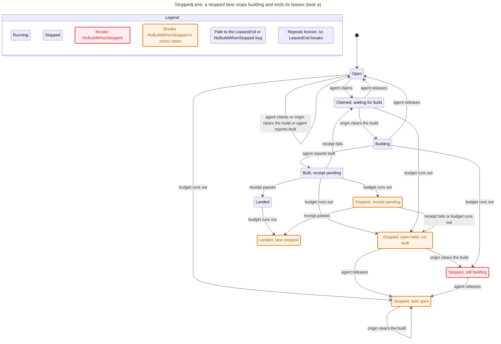

# tla

TLA+ models for the statechart work. The StoppedLane and LaneBudget models are below.

## StoppedLane

Constants: `Tasks = {a, b}`. `Fixed` is FALSE or TRUE. `Mutant` is `"none"`, `"keep_lease"` or `"unstop"`.

Configs (each checks TypeOK, NoBuildWhenStopped, LeaseMeansClaimed as invariants, and LeasesEnd, StopIsFinal as properties):

| cfg | Fixed | Mutant | states (all reachable) |
| --- | --- | --- | --- |
| `StoppedLane_today.cfg` | FALSE | none | 46 |
| `StoppedLane_fixed.cfg` | TRUE | none | 28 |
| `StoppedLane_keep_lease.cfg` | TRUE | keep_lease | 33 |
| `StoppedLane_unstop.cfg` | TRUE | unstop | 28 |

The state count is plain TLC with no rules on each cfg. Every cfg is under the 500-state chart budget.

Init uses `stopped = FALSE`. An earlier draft used `~stopped`, which TLC rejects.

## Commands

```sh
pwsh tla/run.ps1
statechart tla/StoppedLane.tla --config tla/StoppedLane_today.cfg --view tla/views/stopped_lane.view.ts --out tla/out/StoppedLane_today
statechart tla/LaneBudget.tla --config tla/LaneBudget_today_cap1.cfg --view tla/views/lane_budget.view.ts --out tla/out/LaneBudget_today_cap1
```

`run.ps1` writes `tla/out/<cfg>/` and copies `tla2tools.jar` into `tla/.jar/`. Both are git-ignored. It exits 0 only when every expectation in both models holds and the statechart command and plain TLC agree on every rule. The statechart command needs `mise` on PATH; `run.ps1` puts `~/.local/bin` first.

## Results

Expected and recorded by `run.ps1`:

- `_today` breaks NoBuildWhenStopped (5 steps: Claim a, Clear a, Built a, Stop a, Clear a) and LeasesEnd (5 steps). TypeOK, LeaseMeansClaimed and StopIsFinal hold.
- `_fixed` holds all five rules.
- `_keep_lease` breaks LeaseMeansClaimed (4 steps). LeasesEnd also breaks (4 steps). This corrects an earlier expectation, which named only LeaseMeansClaimed. The lease that survives a stop sits on an open task, and `Release` has no fairness on purpose, so nothing forces the agent to let it go. LeasesEnd is the rule that catches that.
- `_unstop` breaks StopIsFinal (5 steps). The other four hold.

## LaneBudget

Constants: `Items = {a, b}`, `RepairRounds = 2`, `MaxEpisodes` is 0, 1 or 3, `Fixed` is FALSE or TRUE, and `Mutant` is `"none"`, `"off_by_one"` or `"unstop"`.

The cap is per round. `classify` in `crates/acan-core/src/repair.rs` (the block that begins with the comment "`max_episodes` caps the open, non-fixed episodes one round considers") gives each round the first `max_episodes` bounceable episodes. The rest stay open for a later round. The lane stops for good only when bounceable work is left and either the rounds are used up or the batch is empty, which happens only when `max_episodes` is 0. The model follows that rule. A receipt bounces a batch K of size `min(MaxEpisodes, bounceable)`, and the lane stops when `rounds >= RepairRounds` or K is empty. The model allows any batch of that size. The code takes the fewest bounces first, then by identity, so the model covers more batches than the code takes.

Configs (each has `CHECK_DEADLOCK FALSE`, invariants `RoundsBounded` and `StopAfterRound`, and properties `ResidueClears` and `StopIsFinal`):

| cfg | MaxEpisodes | Fixed | Mutant | states (all reachable) |
| --- | --- | --- | --- | --- |
| `LaneBudget_today_cap1.cfg` | 1 | FALSE | none | 67 |
| `LaneBudget_today_cap3.cfg` | 3 | FALSE | none | 64 |
| `LaneBudget_fixed_cap3.cfg` | 3 | TRUE | none | 132 |
| `LaneBudget_off_by_one.cfg` | 3 | TRUE | off_by_one | 180 |
| `LaneBudget_unstop.cfg` | 3 | TRUE | unstop | 156 |
| `LaneBudget_cap0.cfg` | 0 | FALSE | none | 16 |

The state count is plain TLC with no rules on each cfg. Every cfg is under the 500-state chart budget.

### Results

Recorded by `run.ps1`. The paths are the report's: "shortest" where the skill reports a shortest path, and TLC's counterexample for a property.

- `_today_cap1` breaks ResidueClears. RoundsBounded, StopAfterRound and StopIsFinal hold. TLC's counterexample has 5 steps. After the owner rules on a, passing receipts repeat forever and a stays in residue.
- `_today_cap3` breaks ResidueClears in the same way, with the same 5-step counterexample. The other three rules hold.
- `_fixed_cap3` holds all four rules.
- `_off_by_one` breaks RoundsBounded in 3 steps: three bounce receipts reach round 3 of 2. The other three rules hold.
- `_unstop` breaks StopIsFinal in 4 steps: two bounce receipts, a stop (budget runs out), then the owner unstops the lane. The other three rules hold.
- `_cap0` breaks StopAfterRound in 1 step: a receipt bounces an item with `MaxEpisodes = 0`, and the lane stops at round 0. This is the only way to stop at round 0 under the current code. ResidueClears breaks in 3 steps. `run.ps1` records that result without gating on it, because this cfg's expectation names only StopAfterRound. RoundsBounded and StopIsFinal hold.

The chart for `_today_cap1` is `tla/out/LaneBudget_today_cap1/chart.mmd`. It draws 31 states and 83 arrows. Every budget-runs-out arrow starts at "2 of 2 rounds used", and no bounce arrow does. The labels count items rather than naming them, because the items are interchangeable.

## What we checked

StoppedLane checks the build cycle of one lane's tasks around a stop. LaneBudget checks one lane's repair budget: how many items it bounces, how many repair rounds it runs, and when it stops. Each model is model-checked at two tasks or two items. The checks cover the models, not the scheduler, as the limits at the end of this section say.

### Properties

A task is claimed while its stage is declared, building or gating. The stages are open, declared, building, gating and landed.

- **TypeOK** (StoppedLane): every task is in one of its five stages, and each task's lease and the stop flag are true or false.
- **NoBuildWhenStopped** (StoppedLane): no task is building once its lane is stopped.
- **LeaseMeansClaimed** (StoppedLane): a task holds a lease exactly when it is claimed.
- **LeasesEnd** (StoppedLane): after a stop, every lease in the lane ends.
- **StopIsFinal** (both models): once a lane is stopped, it stays stopped.
- **RoundsBounded** (LaneBudget): no lane runs more repair rounds than its limit of two.
- **StopAfterRound** (LaneBudget): a lane stops only after at least one repair round has run.
- **ResidueClears** (LaneBudget): every item in residue (an item that waits for a human ruling) is eventually ruled on or the lane stops.

### Constants

- **StoppedLane:** `Tasks = {a, b}`. `Fixed` is FALSE in `StoppedLane_today` and TRUE in the other three cfgs. `Mutant` is `"none"` in `StoppedLane_today` and `StoppedLane_fixed`, `"keep_lease"` in `StoppedLane_keep_lease`, and `"unstop"` in `StoppedLane_unstop`.
- **LaneBudget:** `Items = {a, b}` and `RepairRounds = 2` in every cfg. `MaxEpisodes` is 1 in `LaneBudget_today_cap1`, 3 in `LaneBudget_today_cap3`, `LaneBudget_fixed_cap3`, `LaneBudget_off_by_one` and `LaneBudget_unstop`, and 0 in `LaneBudget_cap0`. `Fixed` is TRUE in `LaneBudget_fixed_cap3`, `LaneBudget_off_by_one` and `LaneBudget_unstop`, and FALSE in the other three. The mutants are `"off_by_one"` in `LaneBudget_off_by_one` and `"unstop"` in `LaneBudget_unstop`, and the other cfgs use `"none"`.

Every cfg sets `CHECK_DEADLOCK FALSE`, because a stopped lane can have no step out, so TLC would report that state as a deadlock.

### State counts

These are the full reachable graphs: plain TLC with no rules, so each count is every state the model reaches. The counts come from the `run.ps1` output. The `tlc.out` files are not used for counts, because they stop at the first violation.

| Cfg | States |
| --- | --- |
| `StoppedLane_today` | 46 |
| `StoppedLane_fixed` | 28 |
| `StoppedLane_keep_lease` | 33 |
| `StoppedLane_unstop` | 28 |
| `LaneBudget_today_cap1` | 67 |
| `LaneBudget_today_cap3` | 64 |
| `LaneBudget_fixed_cap3` | 132 |
| `LaneBudget_off_by_one` | 180 |
| `LaneBudget_unstop` | 156 |
| `LaneBudget_cap0` | 16 |

All of them are under the 500-state chart budget.

### Run results

From the `run.ps1` output, which ends with "Result: all expectations hold". The statechart command and plain TLC agree on every rule.

| Cfg | Rule that breaks | Path length (steps) | Holds |
| --- | --- | --- | --- |
| `StoppedLane_today` | NoBuildWhenStopped | 5 | TypeOK, LeaseMeansClaimed, StopIsFinal |
| `StoppedLane_today` | LeasesEnd | 5 | TypeOK, LeaseMeansClaimed, StopIsFinal |
| `StoppedLane_fixed` | none | none | all five |
| `StoppedLane_keep_lease` | LeaseMeansClaimed | 4 | TypeOK, NoBuildWhenStopped, StopIsFinal |
| `StoppedLane_keep_lease` | LeasesEnd | 4 | TypeOK, NoBuildWhenStopped, StopIsFinal |
| `StoppedLane_unstop` | StopIsFinal | 5 | TypeOK, NoBuildWhenStopped, LeaseMeansClaimed, LeasesEnd |
| `LaneBudget_today_cap1` | ResidueClears | 5 | RoundsBounded, StopAfterRound, StopIsFinal |
| `LaneBudget_today_cap3` | ResidueClears | 5 | RoundsBounded, StopAfterRound, StopIsFinal |
| `LaneBudget_fixed_cap3` | none | none | all four |
| `LaneBudget_off_by_one` | RoundsBounded | 3 | StopAfterRound, ResidueClears, StopIsFinal |
| `LaneBudget_unstop` | StopIsFinal | 4 | RoundsBounded, StopAfterRound, ResidueClears |
| `LaneBudget_cap0` | StopAfterRound | 1 | RoundsBounded, StopIsFinal |

`LaneBudget_cap0` also breaks ResidueClears, in 3 steps. That result is recorded but does not gate the run, because the cfg's expectation names only StopAfterRound.

### Broken variants

Each path is the step list from the `run.ps1` output. Claim a means the agent claims a. Clear a means the origin clears the build of a. Built a means the agent reports a built. Stop a means a receipt for a goes over budget and the lane stops. Unstop means the owner unstops the lane.

- **StoppedLane_today, NoBuildWhenStopped (5 steps):** Claim a, Clear a, Built a, Stop a, Clear a. Task a is building after the lane stops.
- **StoppedLane_today, LeasesEnd (5 steps):** Claim b, Clear b, Built b, Stop b, Clear b. The run then stays with the lane stopped, task b building and its lease held.
- **StoppedLane_keep_lease, LeaseMeansClaimed (4 steps):** Claim a, Clear a, Built a, Stop a. Task a is open and still holds its lease.
- **StoppedLane_keep_lease, LeasesEnd (4 steps):** Claim b, Clear b, Built b, Stop b. The run then stays with the lane stopped and task b open with its lease held.
- **StoppedLane_unstop, StopIsFinal (5 steps):** Claim a, Clear a, Built a, Stop a, Unstop.
- **LaneBudget_today_cap1 and LaneBudget_today_cap3, ResidueClears (5 steps, a lasso):** two receipts that bounce items, a receipt that leaves both items in residue, then owner rulings on b and on a. The run then stays with both items ruled and in residue, with the lane running. Under today's rule, passing receipts never move a residue item, so a stays in residue.
- **LaneBudget_off_by_one, RoundsBounded (3 steps):** three receipts that bounce items. The third reaches round 3 of 2.
- **LaneBudget_unstop, StopIsFinal (4 steps):** two receipts that bounce items, a receipt that stops the lane when its budget runs out, then the owner unstops the lane.
- **LaneBudget_cap0, StopAfterRound (1 step):** one receipt stops the lane at 0 of 2 rounds used. With the cap at 0, no batch can be offered, so the lane stops at round 0.
- **LaneBudget_cap0, ResidueClears (3 steps, recorded only):** a receipt leaves both items in residue, then the owner rules on b and on a.

### Fix for the stop bug

The core fix is commit `cc22b31`, "core: a stopped lane clears no build and ends its leases". Commit `24cf97d` follows it with a test of the stop filter in `build_clear` and a check on task1 after a stop.

The tests are in `crates/acan-core/tests/scope_first.rs` unless noted:

- `a_stopped_lane_trace_replays` replays the StoppedLane_today trace row by row on the real scheduler.
- `a_stop_ends_every_lease_in_the_lane` claims two tasks, drives one of them to a stopping receipt, and checks that both leases end.
- `a_new_probe_spelling_never_resets_the_budget` has a rewritten tail. After the stop, task1 has no fence, and a new claim is rejected with `BudgetExhausted`.
- `clash::tests::a_stopped_lane_clears_no_build_for_a_declared_task` is a unit test in `crates/acan-core/src/clash.rs`.

On the unmodified tree, `a_stopped_lane_trace_replays` fails at row 5: the stop batch cleared task1, and the stop batch holds a `LeaseRenewed`. After the fix, it passes.

### Open items

- The residue exit is unresolved. A held ruling does not yet clear a residue item, so under today's rule `ResidueClears` breaks in the `_today` cfgs. The fixed expectation lands with the residue-exit change.
- The code applies the cap per round (`classify` in `crates/acan-core/src/repair.rs`), so with the offered cap of 4 a lane does not stop at round 0, and only a cap of 0 stops it there. The offered cap is unchanged.
- The residue question is open. The server counts a note as an answer to a residue item (`answered_episode` in `crates/acan-server/src/land.rs`), while the core says a note never settles one (`ruled_episodes` in `crates/acan-core/src/repair.rs`). No decision has been made.

### Chart

The chart is `tla/out/StoppedLane_today/chart.mmd`, copied as written. It follows task a, so it shows the NoBuildWhenStopped path. The LeasesEnd counterexample runs on task b and is not drawn.



### Limits

- The checks are bounded, and they check models.
- The replay covers only the traces it replays, through the fixture, not the server or the workers.
- The known bugs were found by reading code and logs, so say TLC "reproduces" them. Say "found" only for anything new that TLC turns up.

### Voice line

We modelled the lane's build cycle in TLA+ and ran TLC. It reproduces the bug in five steps. The same five steps run as a test on the real scheduler, red before the fix and green after.
